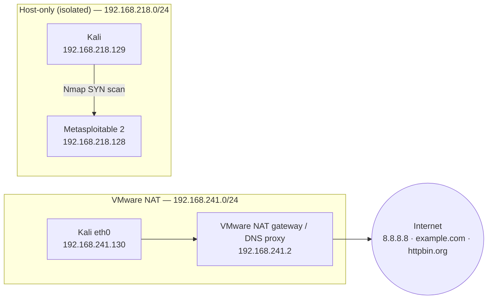
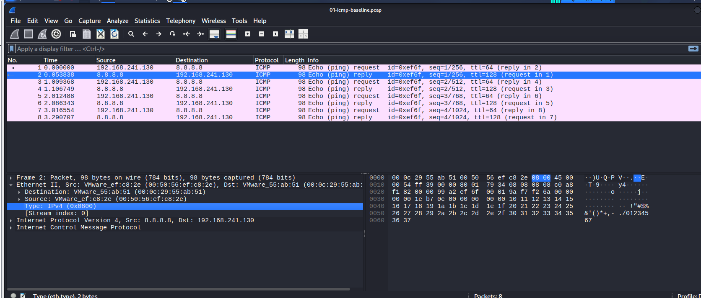
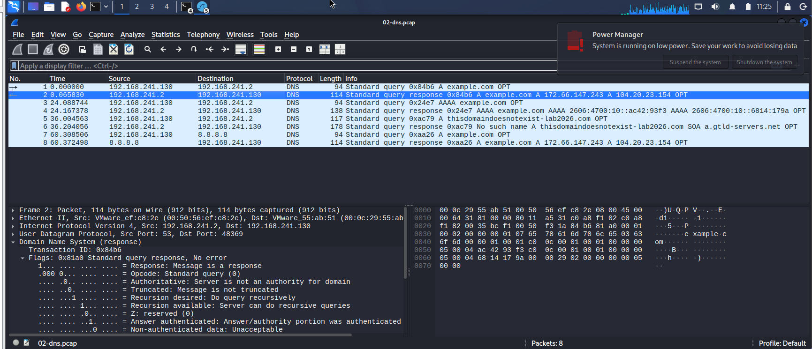
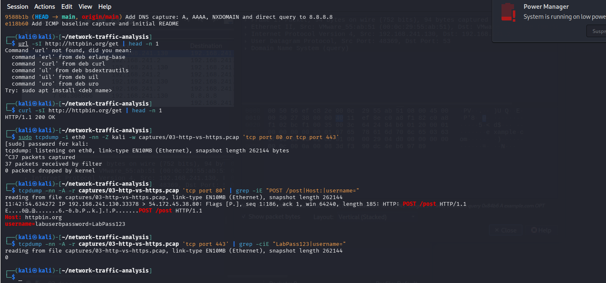
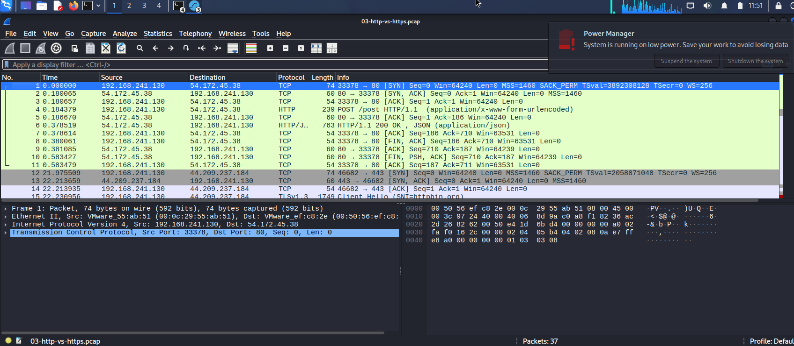
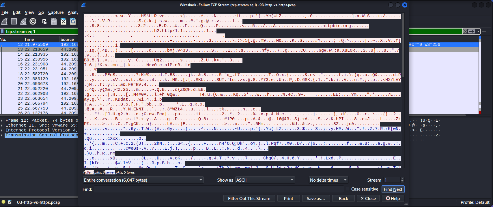
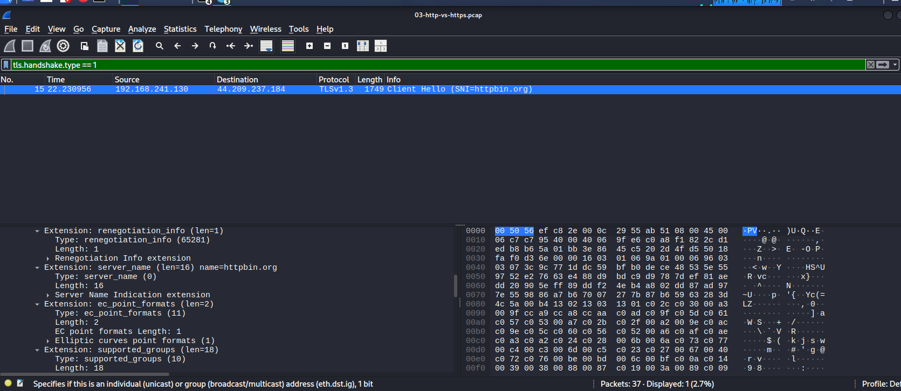
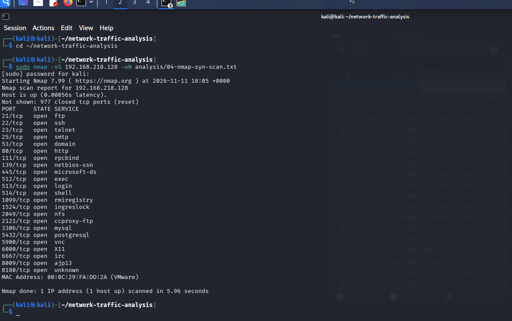
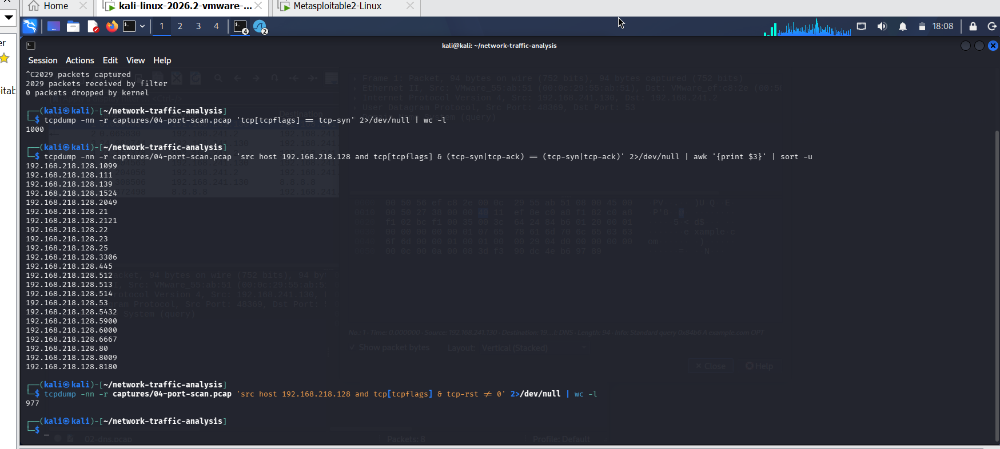

# Network Traffic Analysis Lab

Hands-on network traffic analysis using **tcpdump** and **Wireshark** on Kali Linux (VMware).
Four captures — from a simple ping to a port scan — analysed packet by packet, with every finding cross-checked using a second tool.

> All traffic was generated in my own lab. The only external services contacted were public test endpoints (`8.8.8.8`, `example.com`, `httpbin.org`). The port scan target is **Metasploitable 2**, a deliberately vulnerable VM, on an **isolated host-only network**. No real credentials were used.

---

## Lab Environment

| Component | Details |
|---|---|
| Host | Windows + VMware |
| Analyst / attacker VM | Kali Linux — `192.168.241.130` (NAT) / `192.168.218.129` (host-only) |
| Target VM | Metasploitable 2 — `192.168.218.128` (host-only, no internet) |
| Tools | tcpdump 4.99.6 (libpcap 1.10.6), Wireshark 4.6.6, Nmap, dig, curl 8.22.0, whois, Git 2.53.0 |
| Time zone | UTC (set before capturing so all timestamps line up) |



---

## Captures & Findings

### Capture 01 — ICMP baseline
`captures/01-icmp-baseline.pcap` · 8 packets · 936 bytes

- 4 echo requests / 4 echo replies, 0% loss. RTT per sequence: **53.8 / 97.4 / 73.9 / 274.2 ms** (seq 4 shows jitter).
- File size verified by hand: 24 (pcap header) + 8 × (16 record header + 98 frame) = **936 bytes**.
- Decoded the request from raw hex: Ethernet → IPv4 (TTL 64, DF set, proto 1) → ICMP (type 8, id `0xef6f` = 61295, seq 1).
- ICMP checksum changes from `0x91a2` (request) to `0x99a2` (reply) — exactly `+0x0800` for type 8 → 0.
- The ping payload carries a timestamp: `0x6af2f79a` = **2026-11-10 10:53:14 UTC**, matching the tcpdump timestamp.
- **Finding:** replies arrive with **TTL 128, DF cleared and a new IP ID** — evidence suggests they are generated by VMware NAT (running on Windows, default TTL 128), not received directly from 8.8.8.8.

### Capture 02 — DNS
`captures/02-dns.pcap` · 8 packets (4 queries / 4 responses)

| Query | Server | Result | Time |
|---|---|---|---|
| `A example.com` | 192.168.241.2 | 172.66.147.243, 104.20.23.154 | 65.8 ms |
| `AAAA example.com` | 192.168.241.2 | 2606:4700:10::ac42:93f3, 2606:4700:10::6814:179a | 78.6 ms |
| `A thisdomaindoesnotexist-lab2026.com` | 192.168.241.2 | **NXDOMAIN** (SOA `a.gtld-servers.net`) | 199.5 ms |
| `A example.com` | 8.8.8.8 (direct) | same IPv4 answers | 64.0 ms |

- Resolver confirmed in `/etc/resolv.conf`: `nameserver 192.168.241.2` (VMware NAT DNS proxy).
- tcpdump `$` = **AD flag (DNSSEC)**: confirmed in Wireshark — flags `0x81a0` (AD = 1) on NOERROR answers, `0x8183` (AD = 0, rcode 3) on NXDOMAIN.
- The AAAA records embed the IPv4 addresses (`ac42:93f3` = 172.66.147.243, `6814:179a` = 104.20.23.154). `whois` confirms **Cloudflare, Inc.**
- Frame size − DNS size = **42 bytes** on every packet (14 Ethernet + 20 IP + 8 UDP).
- Wireshark filters: `dns.flags.response == 0` → 4 · `dns.flags.rcode == 3` → 1 · `dns.qry.type == 28` → 2.
- SOC relevance: NXDOMAIN took ~3× longer (not cached); many NXDOMAINs from one host can indicate DGA malware.

### Capture 03 — HTTP vs HTTPS
37 packets: **11 HTTP** (port 80) + **26 HTTPS** (port 443). Same POST with fake credentials `labuser / LabPass123` sent to `httpbin.org` over both.

| What an eavesdropper sees | HTTP | HTTPS |
|---|---|---|
| Password | 🔴 **Yes** — `username=labuser&password=LabPass123` | ✅ No — 0 matches in 26 packets |
| Site name | Yes (`Host:` header) | **Yes** (TLS SNI = `httpbin.org`) |
| Tool / User-Agent | Yes (`curl/8.22.0`) | No |
| Conversation size | 894 bytes | 6,047 bytes (TLS handshake + certificate) |

- Full HTTP exchange read with *Follow HTTP Stream*; `Content-Length: 36` checked by hand.
- HTTPS stream is unreadable except the **SNI** and **ALPN** (`h2`, `http/1.1`) in the TLSv1.3 Client Hello → HTTPS hides content, not metadata.
- Client Hello frame is **1,749 bytes** (> 1,514 MTU) because tcpdump captures before NIC segmentation offload (IP total length `0x06c7` = 1,735).
- The server SYN-ACK carried only the MSS option, again consistent with VMware NAT proxying TCP.
- `whois 54.172.45.38` → Amazon Technologies Inc.

> **Privacy note:** the Capture 03 pcap is kept local (`.gitignore`) because httpbin's JSON response contains the lab's public IP address. Screenshots are provided with the IP redacted.

### Capture 04 — Port scan detection
`captures/04-port-scan.pcap` · 2,029 packets · Nmap results in `analysis/04-nmap-syn-scan.txt`

Attack: `sudo nmap -sS 192.168.218.128` (SYN / half-open scan, top 1,000 ports) — finished in **5.96 s**.

| Packet type | Count | Meaning |
|---|---|---|
| SYN from Kali | 1,000 | one probe per port |
| SYN-ACK from target | 23 | **open** ports |
| RST from target | 977 | **closed** ports |
| RST from Kali | 23 | scanner tears down open ports (half-open) |
| ARP | 4 | host discovery / cache check |
| UDP 138 (NetBIOS) | 2 | background Samba broadcast — not part of the scan |
| **Total** | **2,029** | every packet accounted for |

- 1,000 − 23 = 977 → every port answered, **0 filtered** (no firewall).
- Open ports found in the capture match Nmap exactly: `21 22 23 25 53 80 111 139 445 512 513 514 1099 1524 2049 2121 3306 5432 5900 6000 6667 8009 8180`.
- **Detection indicators:** one source → 1,000 distinct destination ports in ~6 s (~168 ports/s), 977 RST responses, and a client RST right after each SYN-ACK (SYN-scan signature).

---

## Screenshots

| | |
|---|---|
|  <br> **ICMP reply** — TTL 128 from VMware NAT |  <br> **DNS flags** — AD bit (DNSSEC) set |
|  <br> **HTTP** — password in cleartext |  <br> **Follow HTTP Stream** |
|  <br> **HTTPS** — encrypted, only SNI/ALPN readable |  <br> **TLS SNI** — `httpbin.org` exposed |
|  <br> **Nmap SYN scan** — 23 open ports |  <br> **Scan detection** from packets only |

<details>
<summary><b>All screenshots (01 → 19)</b></summary>

| # | Screenshot |
|---|---|
| 01 | [Tool versions](screenshots/01-install-verification.png) |
| 02 | [Capture permissions (no root)](screenshots/02-capture-permissions.png) |
| 03 | [Network fixed — NAT](screenshots/03-network-nat-working.png) |
| 04 | [ICMP capture in tcpdump](screenshots/04-tcpdump-icmp-capture.png) |
| 05 | [ICMP request in Wireshark](screenshots/05-wireshark-icmp-request.png) |
| 06 | [ICMP reply in Wireshark](screenshots/06-wireshark-icmp-reply.png) |
| 07 | [Display filter `icmp.type == 8`](screenshots/07-wireshark-display-filter.png) |
| 08 | [First push to GitHub](screenshots/08-github-first-push.png) |
| 09 | [dig — NXDOMAIN](screenshots/09-dig-nxdomain.png) |
| 10 | [DNS capture in tcpdump](screenshots/10-tcpdump-dns-capture.png) |
| 11 | [DNS flags (AD bit)](screenshots/11-wireshark-dns-flags.png) |
| 12 | [NXDOMAIN filter](screenshots/12-wireshark-nxdomain-filter.png) |
| 13 | [HTTP cleartext credentials](screenshots/13-http-cleartext-credentials.png) |
| 14 | [Follow HTTP Stream](screenshots/14-wireshark-follow-http-stream.png) |
| 15 | [Follow HTTPS Stream](screenshots/15-wireshark-follow-https-stream.png) |
| 16 | [TLS SNI](screenshots/16-wireshark-tls-sni.png) |
| 17 | [Metasploitable on host-only](screenshots/17-metasploitable-ip.png) |
| 18 | [Nmap SYN scan](screenshots/18-nmap-syn-scan.png) |
| 19 | [Scan detection with tcpdump](screenshots/19-tcpdump-scan-detection.png) |

</details>

---

## Challenges & Solutions

| Problem | Diagnosis | Fix |
|---|---|---|
| No internet in the VM | `ping` → *Destination Host Unreachable* from own IP (Bridged mode) | Switched adapter to **NAT** |
| Timestamps 5 h off | VM time zone was America/New_York | `timedatectl set-timezone UTC` |
| Capture file empty (24 bytes) | `-w` overwrote a good capture with an empty run | Re-captured once; new file name per capture — never overwrite evidence |
| `^[[200~` / `bad pattern` in zsh | Bracketed-paste escape codes | `unset zle_bracketed_paste` in `~/.zshrc` |
| Public IP inside a pcap | Found in httpbin's `origin` field | Kept pcap local via `.gitignore`, redacted screenshot |
| Target first came up on NAT | `ip a` showed `192.168.241.131` | Moved Metasploitable to **host-only** before scanning |

---

## Repository Structure

```
network-traffic-analysis/
├── README.md
├── .gitignore                 # keeps capture 03 local (privacy)
├── captures/
│   ├── 01-icmp-baseline.pcap
│   ├── 02-dns.pcap
│   └── 04-port-scan.pcap
├── analysis/
│   └── 04-nmap-syn-scan.txt
└── screenshots/
```

## Reproduce

```bash
# capture (one file per scenario)
sudo tcpdump -i eth0 -nn -Z kali -w captures/<name>.pcap '<filter>'

# read / analyse
tcpdump -nn -r captures/02-dns.pcap
tcpdump -nn -A -r captures/03-http-vs-https.pcap 'tcp port 80'
tcpdump -nn -r captures/04-port-scan.pcap 'tcp[tcpflags] == tcp-syn' | wc -l
wireshark captures/01-icmp-baseline.pcap &
```

## Skills Demonstrated

Packet capture & BPF filters · Wireshark display filters & stream analysis · Manual hex decoding (Ethernet / IPv4 / ICMP / DNS / TCP / TLS) · DNS & DNSSEC flags · TLS metadata (SNI, ALPN) · Port scan detection · Network troubleshooting (VMware NAT / host-only) · Evidence handling & data privacy · Git / SSH workflow

## Key Lessons

1. **Verify with two tools** — every number above was checked in both tcpdump and Wireshark (or with `whois`, `resolv.conf`, hand calculation).
2. **Absence of evidence needs context** — "0 password matches" only meant something after confirming 26 HTTPS packets existed.
3. **Know your capture point** — VMware NAT changed TTLs, TCP options and DNS replies; offload produced frames bigger than the MTU.
4. **Encryption protects content, not metadata.**

---

**Author:** Abdellah Chaou — Cybersecurity student, CMC · [GitHub](https://github.com/abdellahchaou)
